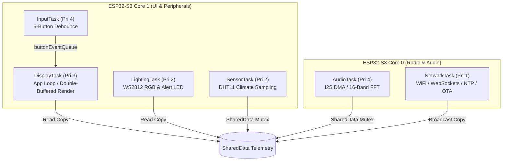

# ORBIT Firmware — Operating System Concepts & FreeRTOS Architecture
**Production Real-Time Architecture for ESP32-S3**

This document details how classical operating system principles are realized in the ORBIT firmware on top of FreeRTOS running on the dual-core Xtensa LX7 (ESP32-S3).

---

## 1. Process Decomposition $\rightarrow$ FreeRTOS Tasks

In an embedded microcontroller environment without virtual memory MMU translation, FreeRTOS **Tasks** serve as the direct equivalent of OS processes. Rather than centralizing subsystem execution into a monolithic Arduino `loop()`, ORBIT decomposes responsibilities into six discrete, independently scheduled tasks.



### Task Specification Matrix

| Task Name | Core | Priority | Stack Size | Target Period | Key Responsibilities |
| :--- | :---: | :---: | :---: | :---: | :--- |
| **`AudioTask`** | 0 | **4** (High) | 4096 B | 5 ms | I2S DMA continuous sampling, 16-band FFT computation, peak/RMS decibel calculation, WAV SD streaming. |
| **`InputTask`** | 1 | **4** (High) | 3072 B | 10 ms | Jitter-free debouncing across 5 tactile buttons, short/hold/repeat threshold detection, event enqueueing. |
| **`DisplayTask`** | 1 | **3** (Medium) | 8192 B | 33 ms (30 FPS) | Button event queue draining, active app state update, RAM canvas rendering, ST7735 SPI DMA flush. |
| **`LightingTask`** | 1 | **2** (Normal) | 3072 B | 20 ms (50 Hz) | Procedural WS2812 RGB mood/disco animations, notification flash patterns, alert LED heartbeat beacon. |
| **`SensorTask`** | 1 | **2** (Normal) | 3072 B | 250 ms | Non-blocking DHT11 climate sampling (temp, humidity, heat index) with 2.5s hardware duty cycle. |
| **`NetworkTask`** | 0 | **1** (Low) | 8192 B | 10 ms | ESP32 WiFi station/AP maintenance, mDNS responder, NTP network time sync, WebSocket telemetry, OTA updates. |

---

## 2. Concurrency & Dual-Core Affinity

The ESP32-S3 contains two independent physical Xtensa 32-bit LX7 cores operating at 240 MHz. ORBIT leverages symmetric multiprocessing (SMP) through `xTaskCreatePinnedToCore()` to eliminate resource starvation and UI jitter:

* **Core 0 (Radio & Audio Core)**: Dedicated to the ESP-IDF WiFi/BT radio stack and real-time audio sampling. Audio DMA processing runs with zero competition from UI frame rendering.
* **Core 1 (Application & UI Core)**: Dedicated to graphics rendering, button debouncing, LED animations, and environmental sensor reads.

> [!NOTE]
> **Zero UI Stuttering**: Pinning the WiFi radio and WebSocket servers to Core 0 guarantees that bursts of network traffic (such as loading web dashboard assets or OTA firmware uploads) never interrupt the 30 FPS display pipeline on Core 1.

---

## 3. Synchronization & Shared Resources

Concurrent access to shared memory structures and hardware buses is governed through FreeRTOS synchronization primitives:

```
+-----------------------------------------------------------------------------+
|                          SYNCHRONIZATION ARCHITECTURE                       |
+-----------------------------------------------------------------------------+

 1. TELEMETRY DATA SYNCHRONIZATION:
    [SensorTask]   ---\
    [AudioTask]    ----+= (Writes) => [SharedData Mutex] => TelemetryData Struct
    [DisplayTask]  ---/                     ^
    [LightingTask] ---- (Reads) ------------+
    [NetworkTask]  ---/

 2. SHARED SPI BUS ARBITRATION:
    [DisplayTask]   -- (Flush 128x160 Frame)  --\
    [AudioTask]     -- (Stream WAV to SD)     ---+= [RenderEngine::_spiMutex]
    [BitmapLoader]  -- (Load Icons/Wallpapers) --/
    [WebServer]     -- (Serve SD Assets)     --/

 3. UI EVENT DECOUPLING (PRODUCER-CONSUMER):
    [InputTask]  --- (Push ButtonEvent)  ---> [buttonEventQueue] ---> [DisplayTask]
```

### Mutex Specification Table

| Resource | Primitive | Timeout | Access Pattern | Protection Objective |
| :--- | :--- | :---: | :--- | :--- |
| **`SharedData`** | Mutex (`SemaphoreHandle_t`) | `15 ms` | Readers: Display, Lighting, Network<br/>Writers: SensorTask, AudioTask | Atomic multi-byte telemetry snapshot copy; prevents dirty reads of climate and audio FFT arrays. |
| **SPI Bus** | Mutex (`RenderEngine::_spiMutex`) | `50–100 ms` | DisplayTask (TFT), AudioTask (SD), BitmapLoader (SD), WebServer (SD) | Eliminates hardware bus contention between ST7735 and MicroSD; coordinates chip-select (`CS`) pin isolation. |
| **`AppRegistry`** | Recursive Mutex (`_registryMutex`) | `50 ms` | Core 1: DisplayTask, InputTask<br/>Core 0: WebSocketServer | Thread-safe active app switching triggered remotely via web dashboard while UI is rendering. |
| **`buttonEventQueue`** | Queue (`QueueHandle_t`) | Non-blocking (`0 ms`) | Producer: InputTask<br/>Consumer: DisplayTask | Lock-free producer-consumer queue (16 elements); allows high-priority input debouncing without stalling the UI. |

---

## 4. CPU Scheduling Policy

FreeRTOS implements a **preemptive, priority-based scheduler with time-slicing**:

1. **High Priority (Priority 4)**:
   * `InputTask`: Tactile pushbuttons demand immediate response to debounce transitions and compute hold thresholds (500ms Back, 2000ms Home).
   * `AudioTask`: I2S DMA buffers must be serviced rapidly to prevent audio ring buffer overflow during sound level analysis and WAV voice memo capture.
2. **Medium Priority (Priority 3)**:
   * `DisplayTask`: Governed by `vTaskDelayUntil()` to achieve a rock-solid 30 FPS display cadence without accumulating timing drift.
3. **Normal / Low Priority (Priority 2 & 1)**:
   * `LightingTask` (Pri 2): LED animations running at 50 Hz.
   * `SensorTask` (Pri 2): DHT11 temperature/humidity sampling is inherently slow (2.5s cycle) and tolerates minor delays.
   * `NetworkTask` (Pri 1): Non-blocking network polling; WiFi packet processing is handled in the background by ESP-IDF network daemons.

---

## 5. Deadlock Prevention Analysis

A classic embedded deadlock risk occurs when multiple resources are acquired simultaneously:

$$\text{DisplayTask locks SPI Mutex} \xrightarrow{\text{waiting for}} \text{Data Mutex}$$
$$\text{SensorTask locks Data Mutex} \xrightarrow{\text{waiting for}} \text{SPI Mutex}$$

### Formal Verification Against Coffman's Four Conditions

| Coffman Condition | System Status | Mitigation in ORBIT Firmware |
| :--- | :--- | :--- |
| **1. Mutual Exclusion** | **Required** | Hardware SPI bus and memory structs cannot be simultaneously written. |
| **2. Hold and Wait** | **Eliminated** | Tasks **never** request a secondary mutex while holding another. `SharedData` methods execute entirely in RAM and never touch SPI. `RenderEngine::flush()` takes the SPI mutex only after the canvas has been rendered in RAM. |
| **3. No Preemption** | **Eliminated** | FreeRTOS tasks can be preempted; tasks waiting on locks will time out and yield. |
| **4. Circular Wait** | **Eliminated** | **Strict Lock Hierarchy**: If nested acquisition is ever required, the acquisition order is strictly enforced: `SPI Mutex` $\rightarrow$ `Data Mutex`. Lock reversal is architecturally forbidden. |

> [!TIP]
> **Defensive Timeouts**: In all task mutex acquisitions, `xSemaphoreTake()` specifies an explicit tick timeout (`pdMS_TO_TICKS(15)` or `pdMS_TO_TICKS(50)`) rather than `portMAX_DELAY`. Even under anomalous hardware bus lockups, no task will remain frozen indefinitely.

---

## 6. Inter-Process Communication (IPC)

ORBIT employs three complementary IPC mechanisms tailored to throughput and coupling requirements:

1. **Shared Memory with Mutex (`SharedData`)**:
   * Used for high-volume, multi-reader telemetry (temperatures, audio FFT bins, network status).
   * Consumers acquire a consistent local copy using `SharedData::getInstance().getData()`.
2. **FreeRTOS Message Queues (`buttonEventQueue`)**:
   * Used for point-to-point asynchronous command transfer between `InputTask` and `DisplayTask`.
   * Guarantees that short taps or fast sequences are never dropped, even if the display is mid-frame.
3. **Decoupled Publish-Subscribe (`EventBus`)**:
   * System-wide event broadcast (`EVENT_SOUND_SPIKE`, `EVENT_RECORDING_START`, `EVENT_NOTIFICATION`, `EVENT_APP_SWITCHED`).
   * Decouples peripheral drivers from UI apps.

---

## 7. Memory Architecture & Capability Tagging

The ESP32-S3 firmware optimizes memory allocation using FreeRTOS heap memory tiers:

* **Internal Fast SRAM (512 KB)**:
  * Used for FreeRTOS task stacks, kernel control blocks, double-buffered display canvas (`Canvas`), and DMA-coherent I2S microphone buffers.
* **External PSRAM / SPIRAM (2–8 MB)**:
  * Used for large static assets, LittleFS web filesystem buffers, decompression tables, and WAV voice memo audio buffers.
* **Task Stack Monitoring**:
  * FreeRTOS stack high-water marking (`uxTaskGetStackHighWaterMark()`) and hardware stack-canary checks detect stack overflows before system corruption can occur.

---

## 8. Summary Mapping

| Classic OS Concept | ORBIT Firmware Implementation | Implementation File |
| :--- | :--- | :--- |
| **Process** | 6 Discrete FreeRTOS Tasks (`Audio`, `Network`, `Input`, `Display`, `Lighting`, `Sensor`) | [src/main.cpp](file:///Users/Inz_mac/Developer/Arduino-Project/orbit/src/main.cpp) |
| **Thread / Concurrency** | Dual-core symmetric multiprocessing via `xTaskCreatePinnedToCore()` | [src/main.cpp](file:///Users/Inz_mac/Developer/Arduino-Project/orbit/src/main.cpp#L187-L250) |
| **Synchronization** | Mutexes (`SharedData`, `_spiMutex`, `_registryMutex`) & CS hardware isolation | [shared_data.cpp](file:///Users/Inz_mac/Developer/Arduino-Project/orbit/src/core/shared_data.cpp), [render_engine.cpp](file:///Users/Inz_mac/Developer/Arduino-Project/orbit/src/display/render_engine.cpp) |
| **IPC** | Thread-safe message queue (`buttonEventQueue`) & Pub-Sub `EventBus` | [main.cpp](file:///Users/Inz_mac/Developer/Arduino-Project/orbit/src/main.cpp#L35), [event_bus.h](file:///Users/Inz_mac/Developer/Arduino-Project/orbit/src/core/event_bus.h) |
| **CPU Scheduling** | Preemptive priority scheduling (Pri 1 to Pri 4) + deterministic pacing (`vTaskDelayUntil`) | [src/main.cpp](file:///Users/Inz_mac/Developer/Arduino-Project/orbit/src/main.cpp#L44-L140) |
| **Deadlock Avoidance** | Bounded tick timeouts (`pdMS_TO_TICKS`) + Strict Lock Hierarchy + Zero Hold-and-Wait | [shared_data.cpp](file:///Users/Inz_mac/Developer/Arduino-Project/orbit/src/core/shared_data.cpp#L22), [render_engine.cpp](file:///Users/Inz_mac/Developer/Arduino-Project/orbit/src/display/render_engine.cpp#L57) |
| **Memory Management** | Capabilities-based segmented memory (Internal SRAM DMA vs External PSRAM) | [config.h](file:///Users/Inz_mac/Developer/Arduino-Project/orbit/include/config.h), [platformio.ini](file:///Users/Inz_mac/Developer/Arduino-Project/orbit/platformio.ini) |
